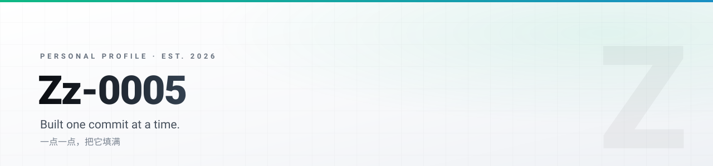

<picture>
  <source media="(prefers-color-scheme: dark)" srcset="assets/dark.svg">
  <source media="(prefers-color-scheme: light)" srcset="assets/light.svg">
  
</picture>

 

## 关于这里

2026 年 10 月建号。这个主页刚刚开始,还没有可以展示的东西,所以我不会在这里堆砌形容词。

它会随着实际做的事一起长起来。

## 这里以后会有什么

| | |
|:--|:--|
| **项目** | 做完的东西,不论大小 |
| **笔记** | 踩过的坑,和想明白的事 |
| **工具** | 自己用得上、别人也可能用得上的脚本 |

## 现在

地基阶段。第一条记录,大概就是这个 README 本身。

 

© 2026 Zz-0005

